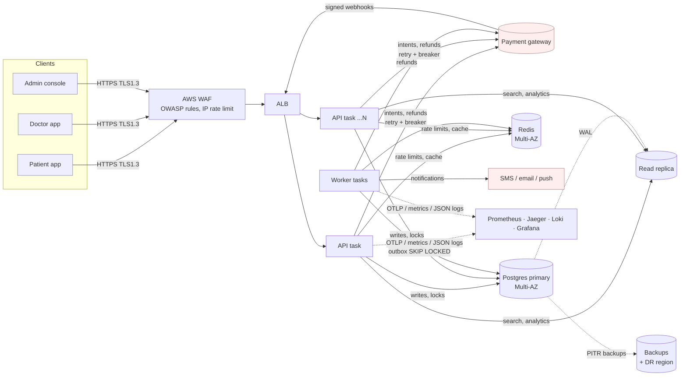
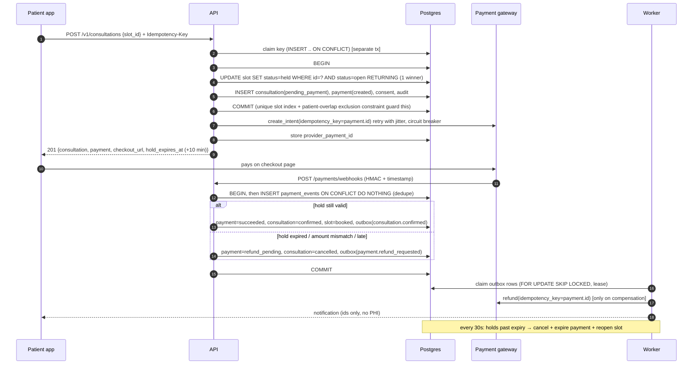
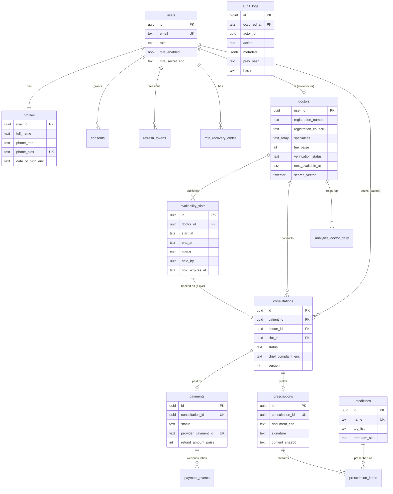

# Architecture: Amrutam Telemedicine Backend

**Scope:** patient/doctor identity, doctor availability and booking, consultations, e-prescriptions,
payments, search, compliance/audit and admin analytics. **Targets:** 100k consultations/day,
p95 < 200 ms reads and < 500 ms writes, 99.95% availability, encryption + MFA + RBAC, metrics,
logs and traces, containerised CI/CD.

## 1. High-level architecture and data flow

A **modular monolith** (one codebase, strict module boundaries, dependency injection) deployed as
two process types from one image: the **API** (FastAPI, stateless, horizontally scaled) and the
**worker** (arq: outbox delivery, saga timeouts, refunds, rollups). The load is high for a
clinic but modest for a database: at 100k consultations/day the peak is ~15 bookings/s and
~150–1,000 reads/s (section 9). Splitting into microservices would add network hops, partial
failure modes and distributed transactions without solving a real bottleneck. The modules
(`auth`, `users`, `doctors`, `availability`, `consultations`, `payments`, `prescriptions`,
`analytics`, `privacy`, `audit`, `outbox`) only talk through services and repositories, so any
of them can be extracted later. Booking and payments would be the first candidates.

**Request path:** WAF → ALB → API task. Middleware runs request-id/log context, CORS, security
headers, body limit and idempotency; then come the rate limit, authentication, RBAC and the
handler. Each module is layered `router → service → repository → models`. Services receive
their collaborators (session, cache, gateway, cipher, signer) through FastAPI dependency
injection, so tests swap them freely. **Writes** commit the state change, its audit record and
its outbox event in **one** Postgres transaction. **Async effects** (notifications, refunds,
rollups) run on the worker from the outbox.

## 2. Booking flow (sequence)

## 3. Data model (ER)

Also: `idempotency_keys`, `outbox_events`, `audit_chain_head` and `analytics_daily`. Columns
ending in `_enc` are AES-256-GCM ciphertext; `_bidx` columns are HMAC blind indexes.

## 4. API schema

REST under `/v1`, documented in **[`docs/openapi.yaml`](openapi.yaml)** (OpenAPI 3.1, generated
from the code; CI fails if it is stale) and served live at `/docs` outside production. Errors use
RFC 9457 `application/problem+json` with a stable `code` and the `request_id`. Every write
accepts `Idempotency-Key`; booking, registration, slot publishing, cancellation, reviews and
prescriptions **require** it.

## 5. Retry and backoff

| Where | Policy |
|---|---|
| Payment gateway calls (API and worker) | `retry_async`: 3 attempts, exponential backoff with **full jitter** (`U(0, min(2s, 0.2s·2ⁿ))`), retries only `TransientError`. Wrapped in a **circuit breaker** (opens after 5 consecutive failures, half-open after 30 s). Every call carries our payment id as the provider idempotency key, so retries are safe. |
| Outbox handlers (worker) | At-least-once delivery; failures reschedule at `1 s + jitter(min(15 min, 2ⁿ s))`. After 8 attempts the event is **dead-lettered** (`status=dead`), alerted on, and can be retried by an admin. Handlers are idempotent (a refund checks `refund_pending` first). |
| Clients | `409 idempotency_in_progress` comes with `Retry-After: 1`, `429` with `Retry-After`. Retrying a booking with the *same* key replays the response; with a *new* key for the same slot it resumes the existing booking. |
| Webhooks | The gateway retries until it gets a 2xx; duplicates are absorbed by the `payment_events` inbox. |

## 6. Data partitioning

* **`audit_logs`**: native range partitions **by month** (`create_monthly_partitions()`, kept 3
  months ahead by a worker cron, with a default partition as a safety net). Time-bounded queries
  prune to a few partitions; retention means detaching old months to cheap storage instead of
  running `DELETE`.
* **Rollups** (`analytics_daily`, `analytics_doctor_daily`) keep dashboards off the hot tables.
* **Next steps at roughly 10× scale:** range-partition `consultations` and `payments` by
  `scheduled_start` month. The slot-uniqueness index becomes `(slot_id, scheduled_start)`, which
  is equivalent because a slot fixes its start time. `availability_slots` would partition by
  `start_at`, dropping past months. Beyond one primary's write capacity, shard by `doctor_id`
  (bookings are doctor-local; patient-overlap checks move to a per-patient lock in the router
  service).

## 7. Caching and concurrency

**Caching:** Redis cache-aside for doctor search (30 s) and profiles (60 s), with
**generation-based invalidation**: keys embed `v{generation}`, and an approval or profile edit
does one `INCR`. That avoids key scans and delete/repopulate races. Redis failures degrade to
cache misses. Data used for booking decisions (open-slot lists, holds) is **never cached**.
Search results include a denormalised `next_available_at` (refreshed each minute and on slot
publish). Load testing showed computing it per row cost 69 ms per query; the stored column
costs 0.4 ms.

**Concurrency, enforced in the database rather than in application checks:**

| Race | Guard |
|---|---|
| Two patients book one slot | Conditional `UPDATE … WHERE status='open' RETURNING` (compare-and-set) plus a partial unique index on `consultations(slot_id)` for live rows |
| A patient double-books themselves | `EXCLUDE USING gist (patient_id =, tstzrange &&)` for active consultations |
| A doctor publishes overlapping slots | `EXCLUDE USING gist (doctor_id =, tstzrange &&)`; overlaps in a batch are skipped |
| Duplicate requests | `idempotency_keys` claimed with an atomic `INSERT … ON CONFLICT … WHERE expired OR crashed` |
| Duplicate webhooks | `payment_events` primary key `(provider, event_id)` |
| Refresh-token replay | Row lock + rotation; reusing a rotated token revokes the whole family |
| Concurrent reviews | A single `UPDATE doctors SET rating_avg = (avg*n + r)/(n+1)` |
| Worker replicas | `FOR UPDATE SKIP LOCKED` + lease on outbox rows and held slots; arq `unique` crons |
| Audit chain appends | `SELECT … FOR UPDATE` on the single `audit_chain_head` row (held only until commit) |

## 8. Transactions and sagas

Each local step is one ACID transaction that also writes its **audit row** and **outbox event**
(transactional outbox), so a crash can never leave a state change without its side effects. The
booking is an **orchestrated saga** (`app/modules/consultations/saga.py`):

| Step | Action | Compensation |
|---|---|---|
| 1 | Hold slot, create consultation + payment | Hold expiry (worker, 10 min): cancel, expire payment, reopen slot |
| 2 | Create payment intent (external, idempotent) | Client retry resumes; failure leaves step 1 to expire |
| 3 | Webhook confirms: consultation `confirmed`, slot `booked` | Late, mismatched or orphaned payment: cancel and **refund** |
| 4 | Refund (worker, external, idempotent) | Retries with backoff, then dead-letter + alert for manual action |

Consultation status follows an explicit state machine (`TRANSITIONS`); illegal moves return 409.

## 9. Scalability and capacity

* **Load:** 100k consultations/day ≈ 1.2 bookings/s on average and ~15/s at a 10× evening peak.
  Browsing is ~10–50 reads per booking, so ~150–600 reads/s at peak. Each booking is ~20 SQL
  statements, so the primary sees a few hundred write statements per second, comfortably within
  one `r6g.xlarge`.
* **Storage:** ~5 KB per consultation including audit ≈ 0.5 GB/day ≈ 180 GB/year before
  partition archival.
* **API:** stateless; ECS autoscaling on CPU (target 55%, because async Python latency degrades
  well before 100% CPU) and on ALB requests per target. `event_loop_lag_seconds` is the
  saturation signal. Database pools are fixed-size per task, with RDS Proxy or PgBouncer in
  front when task count × pool size approaches `max_connections`.
* **Measured:** search over 5,000 doctors and 300,000 slots is p95 36 ms uncached, 8.6 ms cached.
  The laptop load test met both SLOs at about 66 requests/s. At the full peak mix it was limited
  by host CPU contention (see README), so the SLOs need certifying on staging hardware with
  `make load`.

## 10. Backup and DR (summary; full runbook in [`runbooks/dr.md`](runbooks/dr.md))

| Layer | Mechanism | RPO | RTO |
|---|---|---|---|
| AZ failure | RDS Multi-AZ synchronous standby, ElastiCache Multi-AZ, ECS across 3 AZs | 0 | 1–2 min (automatic) |
| Bad deploy / bad data | RDS point-in-time restore (30 days of WAL) | ≤ 5 min | ~30 min |
| Region failure | Automated backups + WAL replicated to **ap-south-2** (Hyderabad, keeping data in India); infrastructure re-created by Terraform | ≤ 15 min | ≤ 2 h |
| Ransomware / operator error | AWS Backup vault with **compliance-mode lock**: daily for 35 days, monthly for 7 years | 24 h | hours |

Redis holds only reconstructible data (caches, rate limits, queues whose state of record is
Postgres), so it isn't backed up for recovery. Restores are drilled quarterly.

## 11. Trade-offs and next steps

* Hash-chaining the audit log serialises audited writes on one row. That's fine at ~30
  writes/s; beyond that, shard the chain (N heads keyed by resource) or seal batches
  asynchronously.
* The mock payment gateway and log-based notifier are adapters behind interfaces; swap in
  Razorpay and an SMS/WhatsApp provider without touching services.
* Planned next: ABDM/ABHA linking for health records, the video provider integration (room
  tokens are already issued), and PgBouncer.
